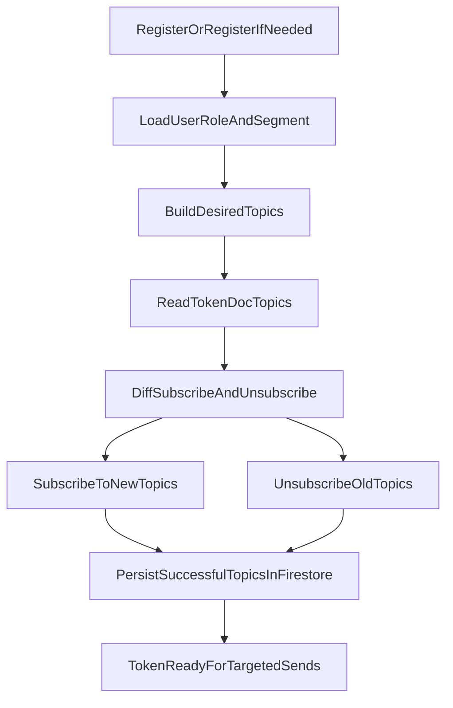

# FCM Topics Rollout Plan

## Scope and decisions

- Use topic names: `role_<role>`, `segment_<segmentId>`, and `all_users`.
- Keep subscriptions in sync when admin updates user `role` or `segmentId`.
- Persist successful topic subscriptions per token in Firestore.

## Data model updates

- Extend token documents in `fcm_tokens/{userId}/tokens/{token}` to include topic metadata:
  - `topics: string[]` (currently active topics for this token)
  - `topicsUpdatedAt: Timestamp`
- Keep existing fields (`token`, `device`, `source`, `isActive`, etc.) unchanged.
- Add `topics` to `FcmTokenRecord` in [`/Users/aanassar/Documents/projects/modawim/modawim/src/shared/types/fcm.types.ts`](/Users/aanassar/Documents/projects/modawim/modawim/src/shared/types/fcm.types.ts) (and optional `topicsUpdatedAt` if needed in UI/API response).

## Topic helper layer in FCM module

- Add topic utilities in [`/Users/aanassar/Documents/projects/modawim/modawim/src/server/modules/fcm/fcm.service.ts`](/Users/aanassar/Documents/projects/modawim/modawim/src/server/modules/fcm/fcm.service.ts):
  - `buildTopicsForUser({ role, segmentId })` -> `string[]`
  - `subscribeTokenToTopics(token, topics)` using Admin SDK `subscribeToTopic`
  - `unsubscribeTokenFromTopics(token, topics)` using Admin SDK `unsubscribeFromTopic`
  - `syncTokenTopics({ userId, token, desiredTopics })`:
    - read existing token doc topics
    - compute `toSubscribe` / `toUnsubscribe`
    - execute topic API calls
    - persist only successful resulting topic set
- Reuse `tokenDocRef(userId, token)` to keep writes scoped per token.

## Registration flow integration

- Update `registerToken` and `registerTokenIfNeeded` in [`/Users/aanassar/Documents/projects/modawim/modawim/src/server/modules/fcm/fcm.service.ts`](/Users/aanassar/Documents/projects/modawim/modawim/src/server/modules/fcm/fcm.service.ts):
  - resolve user role/segment server-side (single source of truth)
  - derive desired topics (`role_*`, optional `segment_*`, `all_users`)
  - call topic sync helper
  - store resulting `topics` in token doc
- Keep return contract for `register-if-needed` (`already_registered | registered | updated`) unless you want a richer status for topic sync.

## Keep subscriptions in sync on admin role/segment edits

- In admin mutation flows (role and segment updates), after DB update, trigger FCM topic resync for affected user tokens:
  - likely files:
    - [`/Users/aanassar/Documents/projects/modawim/modawim/src/server/modules/users/admin-user.controller.ts`](/Users/aanassar/Documents/projects/modawim/modawim/src/server/modules/users/admin-user.controller.ts)
    - [`/Users/aanassar/Documents/projects/modawim/modawim/src/server/modules/users/user.service.ts`](/Users/aanassar/Documents/projects/modawim/modawim/src/server/modules/users/user.service.ts)
- Add a service method like `resyncUserTokenTopics(userId)` in FCM service:
  - fetch user role + segmentId
  - fetch that user’s token docs
  - sync each token topics (chunking where useful)
- Run best-effort with logging so role/segment updates do not fail hard due to transient FCM errors.

## Unregister / cleanup behavior

- On token unregister (`unregisterToken`) and stale-token deletion path:
  - attempt unsubscribe from stored topics before delete (best effort), then delete doc.
  - if topic list is missing, skip unsubscribe and proceed delete.
- On `unregisterAllTokens`, process token docs in batches:
  - unsubscribe each token from its stored topics (best effort)
  - delete docs regardless of unsubscribe outcome.

## Sending by topic endpoints

- Add admin API payload support for topic-targeted sends:
  - `role` topic send
  - `segmentId` topic send
  - `all_users` topic send
- Implement in:
  - DTO: [`/Users/aanassar/Documents/projects/modawim/modawim/src/server/modules/fcm/fcm.dto.ts`](/Users/aanassar/Documents/projects/modawim/modawim/src/server/modules/fcm/fcm.dto.ts)
  - Controller: [`/Users/aanassar/Documents/projects/modawim/modawim/src/server/modules/fcm/fcm.controller.ts`](/Users/aanassar/Documents/projects/modawim/modawim/src/server/modules/fcm/fcm.controller.ts)
  - Service: add `sendToTopic(topic, payload)` wrapper around `firebaseAdminMessaging.send({ topic, ... })`
  - API routes under `/api/admin/fcm/*` following existing style.

## API client and docs updates

- Extend client methods in [`/Users/aanassar/Documents/projects/modawim/modawim/src/lib/api-client.ts`](/Users/aanassar/Documents/projects/modawim/modawim/src/lib/api-client.ts) for new admin topic-send endpoints.
- Update Swagger schema/docs in [`/Users/aanassar/Documents/projects/modawim/modawim/src/server/lib/swagger.ts`](/Users/aanassar/Documents/projects/modawim/modawim/src/server/lib/swagger.ts).
- Update FCM docs with topic architecture and naming in:
  - [`/Users/aanassar/Documents/projects/modawim/modawim/docs/fcm/SYSTEM.md`](/Users/aanassar/Documents/projects/modawim/modawim/docs/fcm/SYSTEM.md)

## Validation and rollout

- Add/adjust tests for:
  - topic derivation from `(role, segmentId)`
  - register path topic persistence
  - role/segment update resync behavior
- Manual checks:
  - new token registration creates expected topics
  - changing role moves token from old role topic to new role topic
  - setting/removing segment adds/removes `segment_*` topic
  - `all_users` is always present
  - topic-targeted send reaches expected audience.

## Flow diagram

