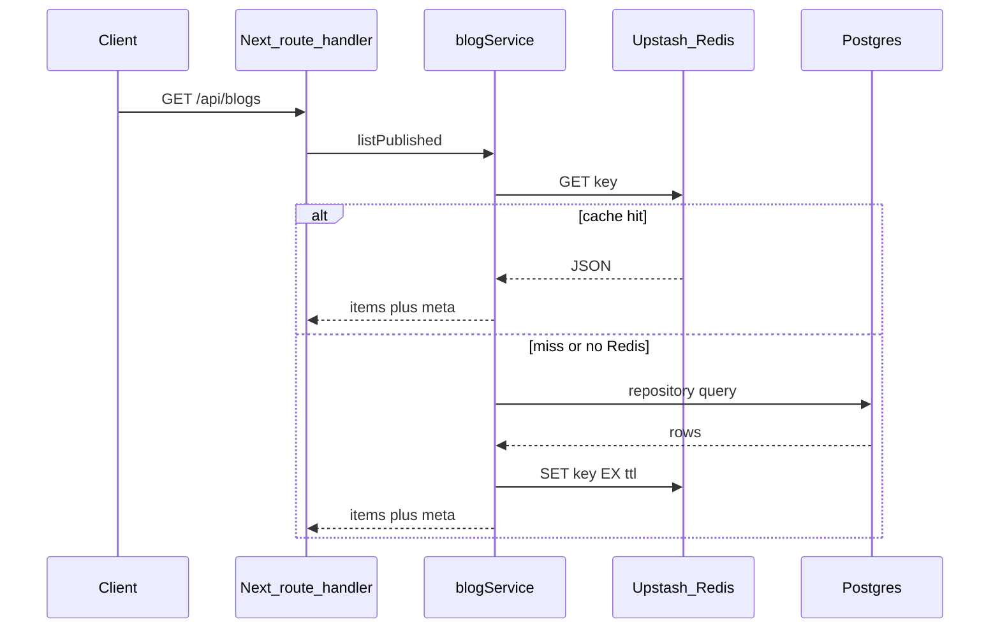

# Server-side caching (Upstash Redis)

This document describes the **Redis-backed cache** used in the Modawim backend. It is **HTTP/REST–based** ([Upstash](https://upstash.com/)), works well with serverless and Node runtimes, and is **optional**: if credentials are missing, the app still runs and reads from Postgres as usual.

## What is cached today

| Area                     | Service method                      | API (examples)            | Notes                                                                                   |
| ------------------------ | ----------------------------------- | ------------------------- | --------------------------------------------------------------------------------------- |
| Featured published blogs | `blogService.listFeaturedPublished` | `GET /api/blogs/featured` | Used by the landing featured section                                                    |
| Published blog lists     | `blogService.listPublished`         | `GET /api/blogs`          | Public `/blogs`, dashboard `/dashboard/blogs`; includes `?tag=`, search `q`, pagination |

**Not cached** (by design today):

- Content blog list (`listAdmin` / `GET /api/content/blogs`)
- Single published post by slug (`getPublishedBySlug`)
- `listPublishedSlugs` and other blog helpers unless explicitly wired later

## High-level flow

Caching happens **inside service layer** methods that the API route handlers call. Values are **JSON** stored in Redis with an **expiration (TTL)**. On a **miss**, the service runs the existing repository/DB logic, then **writes** the result to Redis.



## Environment and configuration

Validated in [`src/server/lib/env.ts`](../../src/server/lib/env.ts):

| Variable                   | Required? | Purpose               |
| -------------------------- | --------- | --------------------- |
| `UPSTASH_REDIS_REST_URL`   | Optional  | Upstash REST endpoint |
| `UPSTASH_REDIS_REST_TOKEN` | Optional  | Upstash token         |

Rules:

- **Both set or both omitted.** If only one is set, env validation fails.
- If **either is missing**, [`getCacheRedis()`](../../src/server/modules/cache/cache.client.ts) returns `null` and all cache operations **degrade to uncached behavior** (no thrown errors from the cache layer for “Redis down” at init).

**Production / CI:** Enter the URL and token **without** surrounding quotes in the dashboard (value should be `https://….upstash.io`, not `"https://….upstash.io"`). The env loader also strips one pair of outer quotes if they were pasted by mistake. Enable these variables for **Production** (and **Preview** if needed); if they are set for **Runtime only** and omitted at **build** time, leaving both unset for the build is fine—they are optional—but a **non-empty invalid** value (typo, stray characters) will still fail validation.

TTL values are **hard-coded** in [`src/server/modules/cache/cache-ttl.ts`](../../src/server/modules/cache/cache-ttl.ts) (currently **24 hours** for blog list caches). They are **not** read from environment variables.

## Generic cache modules

### [`cache.client.ts`](../../src/server/modules/cache/cache.client.ts)

- Exports **`getCacheRedis()`**: lazy singleton `Redis` client from `@upstash/redis`, or `null`.
- Uses validated `env` for URL and token.

### [`cache.service.ts`](../../src/server/modules/cache/cache.service.ts)

| Export                                              | Role                                                                                                                            |
| --------------------------------------------------- | ------------------------------------------------------------------------------------------------------------------------------- |
| `buildCacheKey(prefix, parts)`                      | Joins `prefix` and segments with `:`. Colons inside dynamic `parts` are replaced with `_` to avoid ambiguous keys.              |
| `cacheGet(key)`                                     | Optional read; returns parsed JSON or `null`.                                                                                   |
| `cacheSet(key, value, ttlSeconds)`                  | `SET` with `EX` (seconds).                                                                                                      |
| `cacheGetOrSet(key, ttlSeconds, fetcher, options?)` | Read-through cache: try Redis, on miss run `fetcher`, then `SET`. Best-effort errors on Redis never break the request.          |
| `invalidateByPrefix(prefix)`                        | **`SCAN`** with `MATCH prefix*`, then **`DEL`** keys in batches. Used to drop every variant (all pages/tags) under a namespace. |

**Serialization:** Values are stored as **`JSON.stringify`**. On read, string values are **`JSON.parse`d**; if Redis returns a non-string (some clients), the value is used as-is. Corrupt/unreadable entries trigger a **delete** of that key and a refetch.

### [`cache-ttl.ts`](../../src/server/modules/cache/cache-ttl.ts)

- **`cacheTtlDefaultsSeconds`**: named logical routes (`blogsFeatured`, `blogsPublished`) → seconds.
- **`getCacheTtlSeconds(route)`**: returns the TTL for that route. Extend this object when adding new cached service paths.

## Blog-specific keys: [`blog.cache.ts`](../../src/server/modules/blogs/blog.cache.ts)

### Prefixes

- **`blogs:featured:v1`** — featured lists
- **`blogs:published:v1`** — main published lists

The `:v1` segment is a **version** you can bump if you change key shape or payload format (old keys can be abandoned or cleaned manually).

### How a key name is built

1. Build a stable JSON payload from everything that must change the HTTP response for list endpoints:

   ```json
   { "q": null, "tag": null, "page": 1, "limit": 24 }
   ```

   Fields: **`q`**, **`tag`**, **`page`**, **`limit`** (from [`ListBlogsQueryDTO`](../../src/server/modules/blogs/blog.dto.ts) plus pagination).

2. Hash with **SHA-256**, take the first **32 hex characters**.

3. Final key: **`{prefix}:{hash}`**, e.g.  
   `blogs:published:v1:8c684200767cf14c444603c0ef62c894`

So:

- **Pagination:** different `page` / `limit` → different hash → **different Redis keys** (each page is cached separately).
- **Tag filter:** `tag` in the payload → different hash.
- **Search:** `q` in the payload → different hash.

Helpers: **`featuredBlogsCacheKey`**, **`publishedBlogsCacheKey`**.

### Finding keys in Redis

Redis has no query language. You **scan by pattern**:

- Pattern for all published-list entries: `blogs:published:v1:*`
- Pattern for all featured entries: `blogs:featured:v1:*`

In the Upstash console or `redis-cli`, use **`SCAN`** (or the UI’s key browser) with a **`MATCH`** pattern. To know the **exact** key for a request, either:

- Read **`key`** from **[cache] debug** logs (see below), or
- Temporarily log `publishedBlogsCacheKey(query, page, limit)` in code for the same parameters.

### Invalidation

Blog **create**, **update**, and **delete** call **`invalidatePublicBlogListCaches()`**, which runs:

1. **`invalidateFeaturedBlogsCache()`** — deletes all keys matching `blogs:featured:v1:*`
2. **`invalidatePublishedBlogsCache()`** — deletes all keys matching `blogs:published:v1:*`

So **every** cached page, tag filter, and search variant for those lists is cleared on any successful write. The next visitor for each URL repopulates Redis. Redis failures during invalidation are ignored so writes still succeed.

You can also call **`invalidateFeaturedBlogsCache`** or **`invalidatePublishedBlogsCache`** alone if you add narrower invalidation later.

## Debug logging

[`cacheGetOrSet`](../../src/server/modules/cache/cache.service.ts) accepts optional **`debugLabel`** in the last argument.

Logging is enabled when:

- `NODE_ENV === "development"`, **or**
- `CACHE_DEBUG === "1"`

Disabled when `CACHE_DEBUG === "0"`.

Messages are prefixed with **`[cache]`** and indicate **HIT** (Redis), **MISS** (empty), transport errors, **SET**, corrupt entries, etc. Blog service passes labels such as `GET /api/blogs · tag=foo` so tag-filtered traffic is easy to spot in the server terminal.

## Operational notes

- **Best-effort:** Cache misses, Redis errors, or failed `SET` do not fail the user request; the service falls back to the database.
- **TTL:** Acts as a safety net if invalidation ever fails; 24h is long, but writes still invalidate lists eagerly.
- **Single-instance / serverless:** Upstash is shared; multiple app instances see the same cache.
- **Not browser cache:** This is **server-side** Redis. Client-side behavior (e.g. SWR) is separate.

## Adding a new cached read (checklist)

1. Choose a **stable key**: prefix + hash or structured segments; include **every query input** that affects the response.
2. Add a **TTL** entry in [`cache-ttl.ts`](../../src/server/modules/cache/cache-ttl.ts) and use **`getCacheTtlSeconds("yourRoute")`**.
3. Wrap the read in **`cacheGetOrSet`** with the chosen key and TTL.
4. On **writes** that make the data stale, call **`invalidateByPrefix`** (or a domain helper that wraps it).
5. Optionally pass **`debugLabel`** for `[cache]` logs during development.

## Related files (quick reference)

| File                                                                                           | Purpose                                          |
| ---------------------------------------------------------------------------------------------- | ------------------------------------------------ |
| [`src/server/modules/cache/cache.client.ts`](../../src/server/modules/cache/cache.client.ts)   | Redis client singleton                           |
| [`src/server/modules/cache/cache.service.ts`](../../src/server/modules/cache/cache.service.ts) | Generic get/set/getOrSet/invalidate              |
| [`src/server/modules/cache/cache-ttl.ts`](../../src/server/modules/cache/cache-ttl.ts)         | TTL constants                                    |
| [`src/server/modules/blogs/blog.cache.ts`](../../src/server/modules/blogs/blog.cache.ts)       | Blog key helpers and invalidation                |
| [`src/server/modules/blogs/blog.service.ts`](../../src/server/modules/blogs/blog.service.ts)   | Cached `listPublished` / `listFeaturedPublished` |
| [`src/server/lib/env.ts`](../../src/server/lib/env.ts)                                         | `UPSTASH_REDIS_*` validation                     |
