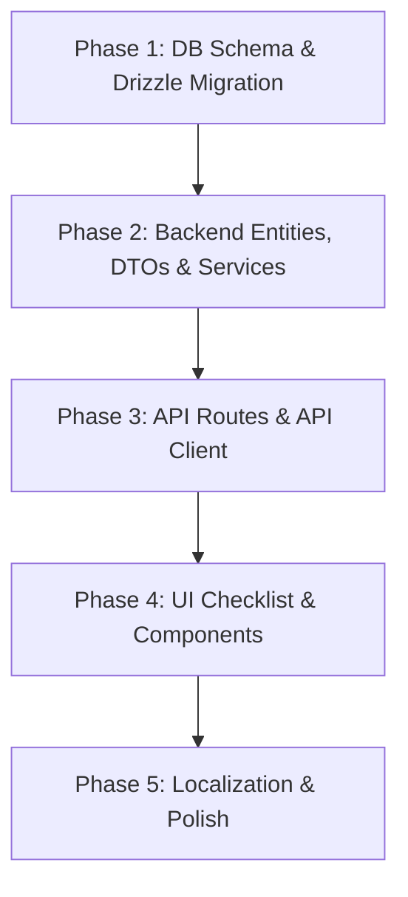

# Goals Steps Refactoring & Migration Plan

This plan outlines the end-to-end transformation of the **Goals** feature from an abstract numeric counter (`targetValue` and `goal_progress` check-in logs) into a structured, milestone-based **Goal Steps** system.

---

## 1. Objectives & Key Changes

1. **Discrete Steps vs. Numeric Target:**
   - Remove `target_value` from `goals`. The total steps of a goal is defined by the count of its defined `goal_steps`.
   - Remove the `goal_progress` logging table.
   - Introduce `goal_steps` with sequential `order` and `completedAt` timestamp.
2. **Interactive Checklist Experience:**
   - Checkboxes to toggle step completion in place (`completedAt = new Date()` or `null`).
   - Instant visual feedback and celebration confetti upon completing a step and when hitting 100%.
   - Ability to add, edit, reorder, and delete steps anytime.
3. **Database Migration with Historical Data Preservation:**
   - Automatically convert existing goals (`targetValue = N`, completed = $K$) into $N$ steps (`"Step 1"`, `"Step 2"`, ..., `"Step N"`).
   - Backfill `completedAt` on the first $K$ steps using the original `goal_progress.createdAt` timestamps.
4. **Adaptive UI & Charts:**
   - Progress ring (`GoalArchCard`) calculates:
     $$\text{Completion \%} = \text{totalSteps} > 0 \ ? \ \text{round}\left(\frac{\text{completedSteps}}{\text{totalSteps}} \times 100\right) : 0$$
   - Goal Detail page features both an **interactive checklist** and a **cumulative completion trend chart** based on step `completedAt` timestamps.

---

## 2. Database Schema & Migration

### Schema Changes (`src/server/modules/goals/goal.entity.ts`)

#### A. New Table: `goal_steps`

```ts
export const goalSteps = pgTable(
  "goal_steps",
  {
    id: text("id")
      .primaryKey()
      .$defaultFn(() => createId()),
    goalId: text("goal_id")
      .notNull()
      .references(() => goal.id, { onDelete: "cascade" }),
    title: text("title").notNull(),
    order: integer("order_index").notNull().default(0),
    completedAt: timestamp("completed_at"),
    createdAt: timestamp("created_at")
      .$defaultFn(() => new Date())
      .notNull(),
    updatedAt: timestamp("updated_at")
      .$defaultFn(() => new Date())
      .$onUpdateFn(() => new Date())
      .notNull(),
  },
  (table) => [
    index("goal_steps_goal_order_idx").using(
      "btree",
      asc(table.goalId),
      asc(table.order),
    ),
    index("goal_steps_goal_completed_idx").using(
      "btree",
      asc(table.goalId),
      asc(table.completedAt),
    ),
  ],
);
```

#### B. Modify `goals` Table

- Drop column `target_value`.
- Keep all other goal metadata (`title`, `description`, `motivationNote`, `plan`, `startDate`, `targetDate`, `category`, `icon`, `priority`, `isArchived`).

---

### Data Migration Workflow

A dedicated migration script will execute the following steps in a database transaction:

1. Create table `goal_steps`.
2. For each record in `goals`:
   - Fetch its `target_value` (integer $N$) and all associated rows from `goal_progress` ordered by `created_at ASC` (count $K$).
   - Total steps to create: $N = \max(1, \text{round}(target\_value))$.
   - Insert $N$ rows into `goal_steps`:
     - `order = 1..N`
     - `title = "Step i"`
     - For $i \le K$: `completedAt = goal_progress[i - 1].createdAt`
     - For $i > K$: `completedAt = null`
3. Drop table `goal_progress`.
4. Drop column `target_value` from `goals`.

---

## 3. Backend & API Refactoring

### DTOs & Types (`src/server/modules/goals/goal.dto.ts` & `src/shared/types/goal.types.ts`)

- **`GoalDTO`:**

  ```ts
  export interface GoalDTO {
    id: string;
    userId: string;
    title: string;
    description: string | null;
    motivationNote: string | null;
    plan: string | null;
    totalSteps: number;
    completedSteps: number;
    completionPercentage: number;
    startDate: string;
    targetDate: string | null;
    isArchived: boolean;
    category: string;
    icon: string | null;
    priority: number;
    createdAt: string;
    updatedAt: string;
    steps?: GoalStepDTO[];
  }
  ```

- **`GoalStepDTO`:**

  ```ts
  export interface GoalStepDTO {
    id: string;
    goalId: string;
    title: string;
    order: number;
    completedAt: string | null;
    createdAt: string;
    updatedAt: string;
  }
  ```

- **Zod Schemas:**
  - `createGoalSchema`:
    - Remove `targetValue`.
    - Add optional `initialSteps: z.array(z.string().trim().min(1).max(255)).optional()`.
  - `createGoalStepSchema`: `{ title: z.string().trim().min(1).max(255) }`.
  - `updateGoalStepSchema`: `{ title?: z.string().trim().min(1).max(255), isCompleted?: z.boolean() }`.
  - `reorderGoalStepsSchema`: `{ stepIds: z.array(z.string().min(1)).min(1) }`.

### Repository & Service Methods (`goal.repository.ts`, `goal.service.ts`)

- Replace `goalProgress` sum subqueries with step count subqueries:
  - `totalSteps`: `COUNT(goal_steps.id)`
  - `completedSteps`: `COUNT(goal_steps.id) FILTER (WHERE completed_at IS NOT NULL)`
- Step Management methods:
  - `findStepsByGoalId(goalId)`
  - `createStep(goalId, { title, order })`
  - `updateStep(stepId, goalId, { title, isCompleted })`
  - `reorderSteps(goalId, stepIds)`
  - `deleteStep(stepId, goalId)`

### API Endpoints (`src/app/api/goals/...`)

| Route                            | Method   | Payload / Response                                                                            |
| -------------------------------- | -------- | --------------------------------------------------------------------------------------------- |
| `/api/goals`                     | `POST`   | Accepts goal fields + optional `initialSteps: string[]`                                       |
| `/api/goals/[id]`                | `GET`    | Returns `GoalDTO` including embedded `steps` list                                             |
| `/api/goals/[id]/steps`          | `GET`    | Returns list of `GoalStepDTO`                                                                 |
| `/api/goals/[id]/steps`          | `POST`   | `{ title: string }` $\rightarrow$ creates step at end of list                                 |
| `/api/goals/[id]/steps/reorder`  | `PUT`    | `{ stepIds: string[] }` $\rightarrow$ batch reorders steps                                    |
| `/api/goals/[id]/steps/[stepId]` | `PUT`    | `{ title?: string, isCompleted?: boolean }` $\rightarrow$ toggles completion or updates title |
| `/api/goals/[id]/steps/[stepId]` | `DELETE` | Removes step                                                                                  |

---

## 4. Frontend & Component Redesign

### 1. `GoalArchCard` (`src/components/dashboard/goals/goal-arch-card.tsx`)

- Completion percentage calculated from `completedSteps / totalSteps`.
- Subtitle display updated: shows `X / Y steps` (or `No steps yet` when 0 steps).
- Concentric rings fill dynamically and turn red at 100%.

### 2. `GoalFormDialog` (`src/components/dashboard/goals/goal-form-dialog.tsx`)

- Remove numeric `targetValue` field.
- Add an intuitive initial steps entry area where users can add 0 or more step titles (via Enter key or chip list) during goal creation.

### 3. `GoalDetail` (`src/components/dashboard/goals/goal-detail.tsx`)

- Replace the old "Log progress" button and progress table with an **interactive step checklist**:
  - **Checklist Item:**
    - Custom styled checkbox.
    - Title with strikethrough when completed.
    - Completed date timestamp badge.
    - Reorder drag handle.
    - Action dropdown: Edit title, Delete step.
  - **Instant Toggle & Celebrations:**
    - Clicking the checkbox calls `apiClient.goals.updateStep(goalId, step.id, { isCompleted: !step.completedAt })`.
    - Triggers confetti on step completion.
    - If completing the final step (hitting 100%), triggers the Trophy Celebration modal.
  - **Inline Add Step:**
    - Simple inline input at the bottom of the checklist: `[ + Add a step... ]` with instant submit on `Enter`.
- **Progress Over Time Chart (`GoalProgressChart`):**
  - Updated to plot steps completed over time using each step's `completedAt` timestamp.
- **TipTap Strategy Plan:** Remains available for broader roadmap notes and thoughts.

### 4. Localization (`src/messages/en/goals.json`, `src/messages/ar/goals.json`)

- Update all dictionary keys:
  - Replace "target value", "progress entries", "number of steps to achieve" with "Steps", "Add step", "Step title", "Mark as completed", etc.

---

## 5. Implementation Phases



1. **Phase 1: Database Schema & Migration**
   - Update `goal.entity.ts`.
   - Create migration script to migrate existing `goal_progress` data to `goal_steps`.
2. **Phase 2: Backend Services & DTOs**
   - Refactor `goal.dto.ts`, `goal.repository.ts`, `goal.service.ts`, `goal.controller.ts`.
3. **Phase 3: API Routes & API Client**
   - Implement `/api/goals/[id]/steps` routes.
   - Update `src/lib/api/goals.api.ts`.
4. **Phase 4: Frontend UI Redesign**
   - Build `GoalStepList` / Checklist component with inline creation and drag-and-drop reordering.
   - Refactor `GoalFormDialog`, `GoalArchCard`, `GoalProgressChart`, and `GoalDetail`.
5. **Phase 5: Localization & Verification**
   - Update `en/goals.json` and `ar/goals.json`.
   - Build and test complete flow (create goal, add steps, toggle completion, reorder steps, view charts).
