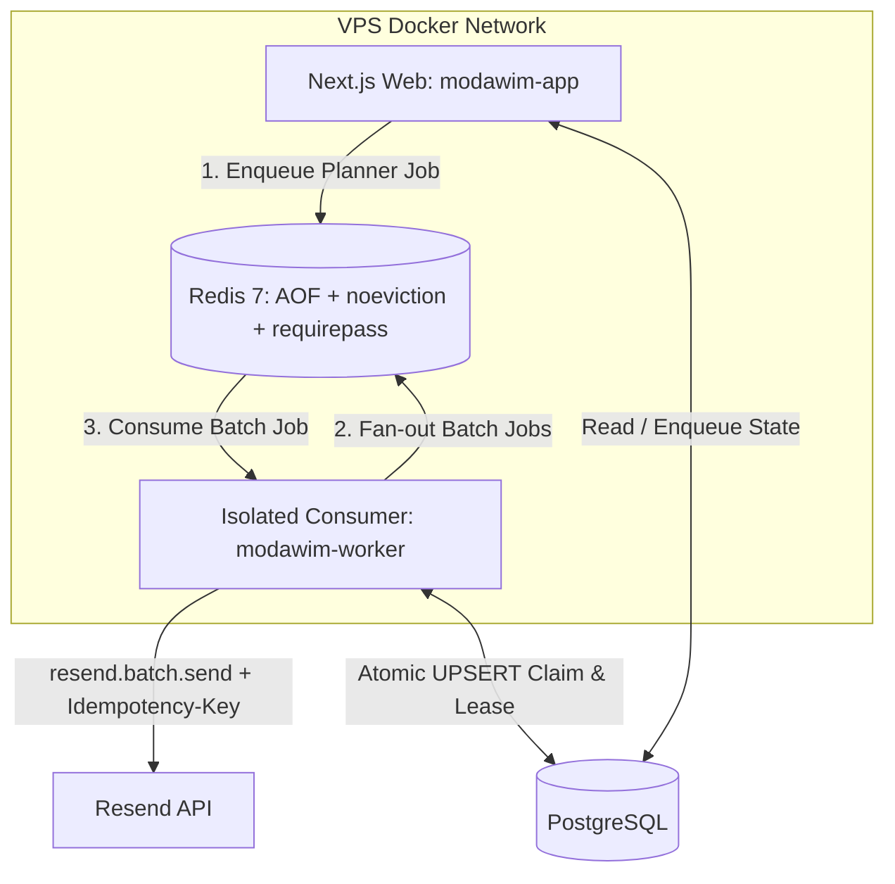

# Production-Hardened MVP Plan: Newsletter Migration from QStash to BullMQ + Local Redis

This document is the revised, battle-tested implementation plan for replacing **Upstash QStash** with **BullMQ** and self-hosted **Redis 7** on the Modawim VPS. It addresses all concurrency, idempotency, rate limiting, and failure edge-cases.

---

## 1. Architecture & Scope Boundary



### Core Decisions

- **Decoupled Scope:** Caching and Rate Limiting remain on Upstash. This migration touches **only** the newsletter queue.
- **Database as Ledger:** PostgreSQL holds the authoritative campaign and delivery states. Redis holds only ephemeral execution tokens.
- **Throughput Target:** 1,000,000 emails in **~2.7 hours** using Resend’s `batch.send` API (100 emails per API call at ~1 request/sec).
- **Delivery Semantics:** At-least-once with **atomic lease claiming** and **Resend idempotency keys** to close duplicate delivery windows.

---

## 2. Infrastructure & Redis Hardening

### 2.1 [docker-compose.yml](file:///Users/aanassar/Documents/projects/modawim/modawim-codebase/docker-compose.yml) Specification

```yaml
services:
  # 1. Web Application
  modawim-app:
    image: ghcr.io/abdelrahman-ahmed-nassar/modawim:latest
    container_name: modawim-app
    restart: unless-stopped
    ports:
      - "4011:3000"
    env_file:
      - .env
    depends_on:
      redis:
        condition: service_healthy
    networks:
      - modawim-network

  # 2. Background Queue Worker
  modawim-worker:
    image: ghcr.io/abdelrahman-ahmed-nassar/modawim:latest
    container_name: modawim-worker
    restart: unless-stopped
    stop_grace_period: 60s # Allows in-flight batches to finish before SIGKILL
    command: ["node", "dist/worker.js"]
    env_file:
      - .env
    depends_on:
      redis:
        condition: service_healthy
    networks:
      - modawim-network

  # 3. Persistent Redis 7
  redis:
    image: redis:7-alpine
    container_name: modawim-redis
    restart: unless-stopped
    # Internal to Docker network only — do NOT publish port 6379 to the host
    command:
      - redis-server
      - --appendonly
      - "yes"
      - --appendfsync
      - everysec
      - --maxmemory-policy
      - noeviction
      - --maxmemory
      - 512mb
      - --requirepass
      - "${REDIS_PASSWORD}"
    volumes:
      - redis_data:/data
    healthcheck:
      test: ["CMD", "redis-cli", "-a", "${REDIS_PASSWORD}", "ping"]
      interval: 5s
      timeout: 3s
      retries: 5
    networks:
      - modawim-network

volumes:
  redis_data:
    driver: local

networks:
  modawim-network:
    driver: bridge
```

---

## 3. Database Schema Migration

Run this Drizzle migration **before** deploying worker or app code.

### 3.1 Drizzle Schema Changes ([src/server/modules/newsletter/newsletter.entity.ts](file:///Users/aanassar/Documents/projects/modawim/modawim-codebase/src/server/modules/newsletter/newsletter.entity.ts))

1. **Enum Update:** Add `'processing'` to `newsletterCampaignSendStatusEnum`:
   ```ts
   export const newsletterCampaignSendStatusEnum = pgEnum(
     "newsletter_campaign_send_status",
     ["pending", "processing", "sent", "failed"],
   );
   ```
2. **Table Updates on `newsletter_campaign_sends`:**
   - Add `locked_until`: `timestamp("locked_until")`
   - Add `claimed_by`: `text("claimed_by")`
   - Add index on `(campaign_id, status)` for fast resume and completion queries.
3. **Table Updates on `newsletter_campaigns`:**
   - Add `resume_generation`: `integer("resume_generation").default(0).notNull()` (avoids Redis job ID collisions).
   - Add `sent_count`: `integer("sent_count").default(0).notNull()`
   - Add `failed_count`: `integer("failed_count").default(0).notNull()`

---

## 4. Redis Client Architecture (`src/server/lib/redis.ts`)

Prevents connection leaks in Next.js development and respects BullMQ's strict worker requirements:

```ts
import Redis from "ioredis";

const redisUrl = process.env.REDIS_URL || "redis://localhost:6379";

declare global {
  var __queueRedis: Redis | undefined;
}

/** Producer connection: Fast-fail timeouts for web HTTP requests */
export function getQueueRedisConnection(): Redis {
  if (process.env.NODE_ENV === "production") {
    return new Redis(redisUrl, {
      maxRetriesPerRequest: 3,
      connectTimeout: 5000,
      commandTimeout: 3000,
      enableReadyCheck: false,
    });
  }
  if (!globalThis.__queueRedis) {
    globalThis.__queueRedis = new Redis(redisUrl, {
      maxRetriesPerRequest: 3,
      connectTimeout: 5000,
      commandTimeout: 3000,
      enableReadyCheck: false,
    });
  }
  return globalThis.__queueRedis;
}

/** Worker connection: maxRetriesPerRequest MUST be null for BullMQ blocking commands */
export function getWorkerRedisConnection(): Redis {
  return new Redis(redisUrl, {
    maxRetriesPerRequest: null,
    enableReadyCheck: false,
  });
}
```

---

## 5. Queue & Worker Implementation

### 5.1 Job Types & Retention Policy

```ts
// src/server/queues/newsletter.types.ts
export type NewsletterPlannerJobData = {
  type: "planner";
  campaignId: string;
  resumeGeneration: number;
};

export type NewsletterBatchJobData = {
  type: "batch";
  campaignId: string;
  batchNumber: number;
  resumeGeneration: number;
  subscriberIds: string[]; // Up to 100 IDs
};

export const NEWSLETTER_QUEUE_NAME = "newsletter-delivery";

export const DEFAULT_JOB_OPTIONS = {
  attempts: 3,
  backoff: {
    type: "exponential",
    delay: 5000,
  },
  // Essential for 512MB RAM + noeviction: prevent completed/failed jobs from exhausting Redis
  removeOnComplete: {
    count: 1000,
    age: 24 * 3600,
  },
  removeOnFail: {
    count: 5000,
  },
};
```

---

### 5.2 Background Planner (Fan-Out Without HTTP Timeouts)

When the admin clicks "Send", `startCampaignSend()` merely updates campaign status to `sending` and enqueues **one single Planner Job** with ID `campaign_${campaignId}_planner_gen_${gen}`.

Inside the worker:

```ts
async function handlePlannerJob(job: Job<NewsletterPlannerJobData>) {
  const { campaignId, resumeGeneration } = job.data;
  const BATCH_SIZE = 100;
  let batchNumber = 0;
  let lastId = "";

  while (true) {
    // Keyset pagination: fast, constant memory
    const subscribers = await db
      .select({ id: newsletterSubscriber.id })
      .from(newsletterSubscriber)
      .where(
        and(
          eq(newsletterSubscriber.status, "active"),
          gt(newsletterSubscriber.id, lastId),
        ),
      )
      .orderBy(newsletterSubscriber.id)
      .limit(BATCH_SIZE);

    if (subscribers.length === 0) break;

    const subscriberIds = subscribers.map((s) => s.id);
    lastId = subscriberIds[subscriberIds.length - 1];

    const jobId = `campaign_${campaignId}_gen_${resumeGeneration}_b_${batchNumber}`;
    await newsletterQueue.add(
      "send-batch",
      {
        type: "batch",
        campaignId,
        batchNumber,
        resumeGeneration,
        subscriberIds,
      },
      { ...DEFAULT_JOB_OPTIONS, jobId },
    );

    batchNumber++;
  }
}
```

---

### 5.3 Batch Processor with Atomic Claiming & Resend Batch API

```ts
// src/server/workers/newsletter-batch.processor.ts
import { Job, Worker, UnrecoverableError } from "bullmq";
import { sql } from "drizzle-orm";
import { db } from "@/server/db";
import { sendNewsletterBatchEmail } from "@/server/lib/resend";
import type { NewsletterBatchJobData } from "@/server/queues/newsletter.types";

export async function processNewsletterBatch(
  job: Job<NewsletterBatchJobData>,
  worker: Worker,
) {
  const { campaignId, subscriberIds } = job.data;
  const claimedBy = `${job.id}_attempt_${job.attemptsMade}`;

  // 1. ATOMIC UPSERT CLAIM: Claim existing pending rows, new rows, or self/expired leases
  const claimedRows = await db.execute<{ subscriber_id: string }>(sql`
    INSERT INTO newsletter_campaign_sends (
      id, campaign_id, subscriber_id, status, locked_until, claimed_by, created_at, updated_at
    )
    SELECT
      gen_random_uuid(),
      ${campaignId},
      s_id,
      'processing',
      NOW() + INTERVAL '2 minutes',
      ${claimedBy},
      NOW(),
      NOW()
    FROM unnest(${subscriberIds}::text[]) AS s_id
    ON CONFLICT (campaign_id, subscriber_id) DO UPDATE
    SET status = 'processing',
        locked_until = NOW() + INTERVAL '2 minutes',
        claimed_by = ${claimedBy},
        updated_at = NOW()
    WHERE newsletter_campaign_sends.status = 'pending'
       OR (
         newsletter_campaign_sends.status = 'processing'
         AND (
           newsletter_campaign_sends.locked_until < NOW()
           OR newsletter_campaign_sends.claimed_by = ${claimedBy}
         )
       )
    RETURNING subscriber_id;
  `);

  const eligibleIds = claimedRows.map((r) => r.subscriber_id);
  if (eligibleIds.length === 0) {
    return { sent: 0, skipped: subscriberIds.length };
  }

  try {
    // 2. Fetch subscriber email, locale & token fresh from Postgres
    const recipients = await db
      .select()
      .from(newsletterSubscriber)
      .where(
        and(
          inArray(newsletterSubscriber.id, eligibleIds),
          eq(newsletterSubscriber.status, "active"),
        ),
      );

    const campaign = await newsletterRepository.getCampaignById(campaignId);
    if (!campaign) throw new UnrecoverableError("Campaign missing");

    // 3. Prepare Batch Payload (up to 100 emails in one request)
    const emailPayloads = recipients.map((sub) => ({
      to: sub.email,
      subject: localizedField(
        sub.locale,
        campaign.subjectAr,
        campaign.subjectEn,
      ),
      html: renderBodyWithFooter(campaign, sub),
      listUnsubscribe: buildUnsubHeader(sub.locale, sub.unsubscribeToken),
    }));

    // 4. Send via Resend with Idempotency Key
    const batchIdempotencyKey = `camp_${campaignId}_job_${job.id}_att_${job.attemptsMade}`;
    const resendResult = await sendNewsletterBatchEmail(emailPayloads, {
      idempotencyKey: batchIdempotencyKey,
    });

    if (resendResult.rateLimited) {
      // PROPER BULLMQ 429 HANDLING: Delay queue without consuming attempt
      const delayMs = (resendResult.retryAfterSec || 5) * 1000;
      await worker.rateLimit(delayMs);
      throw Worker.RateLimitError();
    }

    if (!resendResult.ok) {
      throw new Error(`Resend batch dispatch failed: ${resendResult.error}`);
    }

    // 5. Batch Finalize in Database
    await db.transaction(async (tx) => {
      for (let i = 0; i < recipients.length; i++) {
        const sub = recipients[i];
        const res = resendResult.items[i];
        await tx.execute(sql`
          UPDATE newsletter_campaign_sends
          SET status = ${res.ok ? "sent" : "failed"},
              resend_message_id = ${res.ok ? res.id : null},
              error = ${res.ok ? null : res.error},
              locked_until = NULL,
              claimed_by = NULL,
              updated_at = NOW()
          WHERE campaign_id = ${campaignId} AND subscriber_id = ${sub.id}
        `);
      }

      // Update counters atomically via SQL increment
      await tx.execute(sql`
        UPDATE newsletter_campaigns
        SET sent_count = sent_count + ${resendResult.successCount},
            failed_count = failed_count + ${resendResult.failCount}
        WHERE id = ${campaignId}
      `);
    });

    // 6. Atomic Completion Check
    await checkAndMarkCampaignCompletion(campaignId);
  } catch (error) {
    // Release claimed rows back to 'pending' on transient failures
    await db.execute(sql`
      UPDATE newsletter_campaign_sends
      SET status = 'pending', locked_until = NULL, claimed_by = NULL, updated_at = NOW()
      WHERE campaign_id = ${campaignId}
        AND subscriber_id = ANY(${eligibleIds}::text[])
        AND status = 'processing'
        AND claimed_by = ${claimedBy}
    `);
    throw error;
  }
}
```

---

### 5.4 Atomic Campaign Completion Check

```ts
async function checkAndMarkCampaignCompletion(campaignId: string) {
  const remaining = await db.execute<{ count: number }>(sql`
    SELECT COUNT(*)::int AS count
    FROM newsletter_campaign_sends
    WHERE campaign_id = ${campaignId}
      AND status IN ('pending', 'processing')
  `);

  if (remaining[0]?.count === 0) {
    await db.execute(sql`
      UPDATE newsletter_campaigns
      SET status = 'completed',
          completed_at = NOW()
      WHERE id = ${campaignId} AND status = 'sending'
    `);
  }
}
```

---

## 6. Safe Resume Campaign Architecture

When an admin clicks **"Resume Campaign"**:

1. Check that `campaign.status === 'sending'`.
2. Increment `resume_generation` on the campaign:
   ```sql
   UPDATE newsletter_campaigns
   SET resume_generation = resume_generation + 1
   WHERE id = $1
   RETURNING resume_generation;
   ```
3. Enqueue a new **Planner Job** with the new `resumeGeneration`.
4. The planner queries subscribers who:
   - Have no send row, OR
   - Have a send row with `status = 'pending'`, OR
   - Have a send row with `status = 'processing'` AND `locked_until < NOW()`.
5. Because `resumeGeneration` changed, all child job IDs are distinct (e.g. `campaign_X_gen_1_b_0`), preventing BullMQ custom ID collisions.
6. The atomic UPSERT claiming ensures that if any background worker is still active, overlapping records are cleanly skipped.

---

## 7. Worker Process & Deployment Build

### 7.1 Entrypoint Script (`src/server/workers/run-worker.ts`)

```ts
import { Worker } from "bullmq";
import { getWorkerRedisConnection } from "@/server/lib/redis";
import { processNewsletterBatch } from "./newsletter-batch.processor";
import { NEWSLETTER_QUEUE_NAME } from "@/server/queues/newsletter.types";

const connection = getWorkerRedisConnection();

export const worker = new Worker(
  NEWSLETTER_QUEUE_NAME,
  async (job) => {
    if (job.data.type === "planner") {
      return handlePlannerJob(job);
    }
    return processNewsletterBatch(job, worker);
  },
  {
    connection,
    concurrency: 3, // 3 concurrent batches
    limiter: {
      max: 1, // 1 job
      duration: 1000, // per 1 second (~100 emails/s = 2.7h for 1M)
    },
  },
);

// Graceful shutdown handling Docker stop_grace_period (60s)
let isShuttingDown = false;
async function shutdown(signal: string) {
  if (isShuttingDown) return;
  isShuttingDown = true;
  console.info(`[worker] Received ${signal}. Draining active jobs...`);
  await worker.close();
  await connection.quit();
  console.info("[worker] Shutdown complete.");
  process.exit(0);
}

process.on("SIGTERM", () => shutdown("SIGTERM"));
process.on("SIGINT", () => shutdown("SIGINT"));
```

### 7.2 Worker Build Verification in `package.json`

- Mark `bullmq` and `ioredis` external or bundle cleanly:
  ```json
  "build:worker": "esbuild src/server/workers/run-worker.ts --bundle --platform=node --target=node22 --outfile=dist/worker.js --external:pg-native --external:ioredis --external:bullmq"
  ```
- Test in Phase 4 that `dist/worker.js` contains zero Next.js `server-only` or client-component imports.

---

## 8. Cutover & Rollout Sequence

To ensure **zero dropped emails and zero downtime**:

```
Step 1: Apply Drizzle DB Migration
        (Add 'processing' enum, locked_until, claimed_by, resume_generation, sent_count, indexes)
        ▼
Step 2: Update VPS docker-compose.yml
        (Spin up redis:7-alpine with healthcheck and volume)
        ▼
Step 3: Deploy Worker & Updated App Containers
        (Worker boots and connects to healthy Redis)
        ▼
Step 4: Drain or Resume In-Flight Campaigns
        (Any paused campaign in 'sending' is resumed via the new Resume endpoint)
        ▼
Step 5: Decommission QStash
        (Delete src/server/lib/qstash.ts, webhook route, and remove @upstash/qstash)
```

---

## 9. Testing & Dry-Run Mode

- **Dry-Run Mode (`RESEND_DRY_RUN=true`):**
  Add an environment switch in `resend.ts` that logs outbound payload metrics and returns mock Resend message IDs without sending actual emails.
  - Allows end-to-end load testing of 100,000 to 1,000,000 enqueues on local dev or staging.
  - Verifies memory consumption in Redis under `512mb` with `removeOnComplete`.
  - Verifies that killing the worker container mid-batch recovers cleanly without duplicate records.
