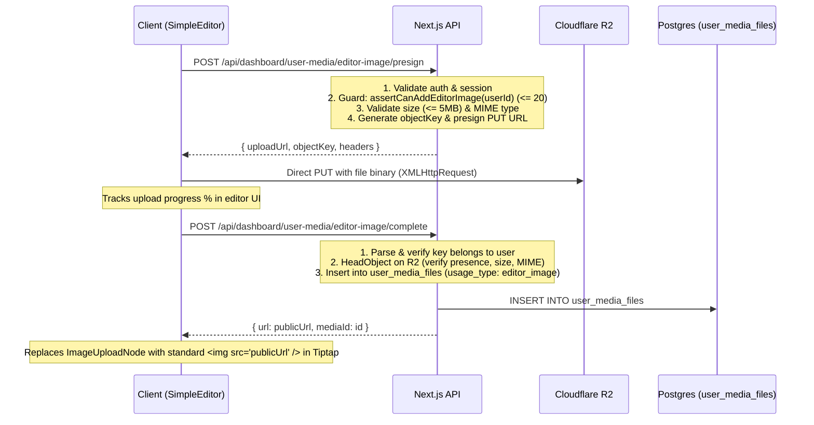

# Implementation Plan: Editor Image Upload & Subscription Entitlements

> **Specification Reference:** Adheres to [`docs/BACKEND_MODULE_GUIDE.md`](../BACKEND_MODULE_GUIDE.md), [`docs/storage/R2_JOURNAL_DAILY_COVER.md`](../storage/R2_JOURNAL_DAILY_COVER.md), and existing direct-to-storage R2 patterns across `books`, `courses`, and `journal_daily`.

---

## 1. Overview & Objectives

Enable users to upload images directly from inside the rich-text editor ([`SimpleEditor`](file:///Users/aanassar/Documents/projects/modawim/modawim-codebase/src/components/tiptap-templates/simple/simple-editor.tsx)) via **Cloudflare R2** direct-to-storage presigned uploads, persist metadata in the `user_media_files` table, and enforce subscription plan limits:

- **Free Plan Limit:** 20 editor images (`maxEditorImages: 20`)
- **Trial Plan Limit:** 20 editor images (`maxEditorImages: 20`)
- **Pro Plan Limit:** Unlimited (`maxEditorImages: null`)
- **File Constraints:** Max 5MB (`USER_MEDIA_MAX_IMAGE_BYTES`), allowed formats: JPEG, PNG, WebP, JPG, AVIF.
- **Scope:** Universally active anywhere [`SimpleEditor`](file:///Users/aanassar/Documents/projects/modawim/modawim-codebase/src/components/tiptap-templates/simple/simple-editor.tsx) is used (Notes, Daily Journal entries, Course lessons, Books reviews, Plans).

---

## 2. High-Level Architecture & Flow



---

## 3. Detailed Implementation Steps

### Phase 1: Shared Constants & Types

1. **[`src/shared/constants/user-media.constants.ts`](file:///Users/aanassar/Documents/projects/modawim/modawim-codebase/src/shared/constants/user-media.constants.ts):**
   - Add `EDITOR_IMAGE: "editor_image"` to `USER_MEDIA_USAGE_TYPE`.
2. **[`src/shared/types/subscription.types.ts`](file:///Users/aanassar/Documents/projects/modawim/modawim-codebase/src/shared/types/subscription.types.ts):**
   - Add `maxEditorImages: number | null` to `PlanFeatures`.
3. **[`src/server/exceptions/exceptions.ts`](file:///Users/aanassar/Documents/projects/modawim/modawim-codebase/src/server/exceptions/exceptions.ts):**
   - Add `"editor_images"` to `PlanLimitKind`.
   - Add error message formatting in `PlanLimitExceededException`:
     `kind === "editor_images" ? "Your plan allows at most ${limit} uploaded editor images." : ...`

---

### Phase 2: Subscription Entitlements & Guard

1. **[`src/server/modules/subscriptions/subscription-entitlements.ts`](file:///Users/aanassar/Documents/projects/modawim/modawim-codebase/src/server/modules/subscriptions/subscription-entitlements.ts):**
   - Update `PLAN_FEATURES`:
     - `[SubscriptionPlanEnum.FREE]`: `maxEditorImages: 20`
     - `[SubscriptionPlanEnum.TRIAL]`: `maxEditorImages: 20`
     - `[SubscriptionPlanEnum.PRO]`: `maxEditorImages: null`
2. **[`src/server/modules/subscriptions/entitlement-guards.ts`](file:///Users/aanassar/Documents/projects/modawim/modawim-codebase/src/server/modules/subscriptions/entitlement-guards.ts):**
   - Implement `assertCanAddEditorImage(userId: string): Promise<void>`:

     ```typescript
     export async function assertCanAddEditorImage(
       userId: string,
     ): Promise<void> {
       const { features } = await subscriptionService.getEntitlements(userId);
       const max = features.maxEditorImages;
       if (max == null) return;

       const count = await userMediaRepository.countByUploadedByAndUsageType(
         userId,
         USER_MEDIA_USAGE_TYPE.EDITOR_IMAGE,
       );
       if (count >= max) {
         throw new PlanLimitExceededException("editor_images", max);
       }
     }
     ```

3. **[`src/lib/subscription-utils.ts`](file:///Users/aanassar/Documents/projects/modawim/modawim-codebase/src/lib/subscription-utils.ts):**
   - Add editor image limit entry to `getPlanFeatureSections` for user-facing subscription comparison.

---

### Phase 3: Backend User-Media Module (`src/server/modules/user-media/`)

1. **Object Keys (`r2-editor-image.keys.ts`):**
   - Pattern: `user-media/editor_image/{userId}/{createId()}.{ext}`
   - Functions:
     - `buildEditorImageObjectKey(userId, contentType)`
     - `parseEditorImageObjectKey(objectKey, userId)`
2. **DTO & Validation (`editor-image.dto.ts`):**
   - `editorImagePresignRequestSchema`:
     - `contentType`: enum from `USER_MEDIA_ALLOWED_IMAGE_TYPES`
     - `fileSize`: positive int up to `USER_MEDIA_MAX_IMAGE_BYTES` (5MB)
   - `editorImageCompleteRequestSchema`:
     - `objectKey`: string min 1, max 512
3. **Service (`editor-image.service.ts`):**
   - `presignUpload(userId, dto)`:
     - Checks R2 storage enabled (`assertR2Enabled()`).
     - Invokes `assertCanAddEditorImage(userId)`.
     - Validates size and MIME type.
     - Generates `objectKey` and presigns S3 `PutObjectCommand`.
     - Returns `{ uploadUrl, objectKey, headers }`.
   - `completeUpload(userId, dto)`:
     - Validates `objectKey` format & user ownership.
     - Executes `headR2Object(objectKey)` to verify object exists, size, and content-type.
     - Inserts new row into `user_media_files` table (`usageType: "editor_image"`).
     - Returns `{ url: publicUrl, mediaId: id }`.
4. **Controller (`editor-image.controller.ts`):**
   - `presign(req: NextRequest)`
   - `complete(req: NextRequest)`

---

### Phase 4: API Route Handlers

Create standard wrapped route handlers matching `journal-daily-cover`:

1. **`src/app/api/dashboard/user-media/editor-image/presign/route.ts`**:
   - Uses `compose(withErrorHandler, withAuth)`.
   - Invokes `editorImageController.presign(req)`.
2. **`src/app/api/dashboard/user-media/editor-image/complete/route.ts`**:
   - Uses `compose(withErrorHandler, withAuth)`.
   - Invokes `editorImageController.complete(req)`.

---

### Phase 5: Client Upload Utility & Tiptap Integration

1. **Client Upload Utility (`src/lib/assets/r2-editor-image-upload.ts`):**
   - Follows `r2-journal-daily-cover-upload.ts`:
     - Pre-validates file locally (format + size).
     - `POST` to `/api/dashboard/user-media/editor-image/presign`.
     - `uploadWithProgress` via `XMLHttpRequest` directly to R2 presigned PUT URL.
     - `POST` to `/api/dashboard/user-media/editor-image/complete`.
     - Returns `{ url: string, mediaId: string }`.
2. **Tiptap Integration in [`simple-editor.tsx`](file:///Users/aanassar/Documents/projects/modawim/modawim-codebase/src/components/tiptap-templates/simple/simple-editor.tsx):**
   - Uncomment extensions:
     - `import { Image } from "@tiptap/extension-image"`
     - `import { ImageUploadNode } from "@/components/tiptap-node/image-upload-node/image-upload-node-extension"`
     - `import "@/components/tiptap-node/image-node/image-node.scss"`
     - `import { ImageUploadButton } from "@/components/tiptap-ui/image-upload-button"`
   - Register `Image` and configure `ImageUploadNode`:
     ```typescript
     ImageUploadNode.configure({
       accept: USER_MEDIA_ALLOWED_IMAGE_TYPES.join(","),
       maxSize: USER_MEDIA_MAX_IMAGE_BYTES,
       upload: async (file, onProgress, abortSignal) => {
         const res = await uploadEditorImageFromFile(
           file,
           (ratio) => onProgress?.({ progress: Math.round(ratio * 100) }),
           { signal: abortSignal },
         );
         return res.url;
       },
       onError: (err) => {
         toast.error(getErrorMessage(err));
       },
     });
     ```
   - Add `ImageUploadButton` into `MainToolbarContent` (and mobile toolbar).

---

## 4. Verification & Testing Checklist

- [ ] **Typecheck & Lint:** Run `pnpm typecheck` and `pnpm lint`.
- [ ] **Presign Validation:** Verify 401 when unauthenticated, 422 when file > 5MB or invalid MIME type.
- [ ] **Entitlement Guard:**
  - On Free/Trial: Verify user can upload up to 20 editor images. Verify the 21st upload triggers 403 `PlanLimitExceededException`.
  - On Pro: Verify unlimited uploads are permitted.
- [ ] **Storage & Database:**
  - Verify file successfully uploads to Cloudflare R2 bucket.
  - Verify corresponding row is inserted into `user_media_files` with `usage_type = "editor_image"`.
- [ ] **Editor UX:**
  - Verify clicking the image upload toolbar button triggers dropzone/file picker.
  - Verify uploading shows progress percentage.
  - Verify on success it replaces the upload node with the rendered image (``).
  - Verify dragging and dropping an image directly onto the editor triggers the upload.
