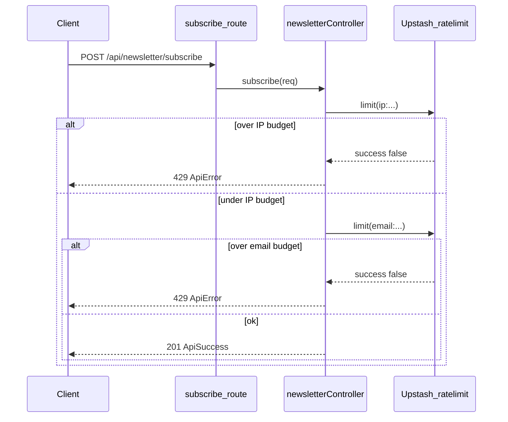

# Rate limiting (Upstash Redis + `@upstash/ratelimit`)

This document describes **abuse protection** for a small set of public and auth-adjacent entry points. It complements [server-side caching](../caching/caching.md): both use the same **Upstash Redis** credentials, but rate limiting is implemented in a separate module and reads **`process.env` directly** (not [`src/server/lib/env.ts`](../../src/server/lib/env.ts)), so it stays safe to import from code that must not pull the full server env graph.

## Goals

- Throttle **credential stuffing**, **password-reset spam**, **newsletter subscribe abuse**, and **mass sign-up** attempts.
- Use **sliding windows** where burst smoothing matters (login, forgot-password, subscribe) and a **fixed window** for a strict, predictable cap on sign-up attempts. **Windows are balanced** (login ~**1 min**; forgot / subscribe / sign-up ~**5 min**) so abuse is slowed without ultra-tight 30s locks.
- Apply **IP-based** limits on **direct HTTP** to Better Auth (`hooks.before` when `ctx.request` exists) and on **newsletter subscribe** in the controller, plus **email + IP** inside **server actions** for the main UI flows.
- Keep behavior **optional**: if Redis URL/token are missing, every limiter **no-ops** (requests always pass the rate limit check).

## Environment

| Variable                   | Required? | Purpose                                |
| -------------------------- | --------- | -------------------------------------- |
| `UPSTASH_REDIS_REST_URL`   | Optional  | Same as caching: Upstash REST endpoint |
| `UPSTASH_REDIS_REST_TOKEN` | Optional  | Same as caching: Upstash token         |

If **either** variable is unset or empty after trim, [`getRateLimitRedis()`](../../src/lib/ratelimit.ts) resolves to `null` and all limiters become **pass-through**. Production and staging that need real limits should set **both**, matching the “both or neither” rule enforced for the rest of the app in `env.ts`.

**Operational note:** The first successful initialization **memoizes** limiter instances for the lifetime of the process. In local dev, starting without Redis and then adding credentials typically requires a **process restart** for limits to engage.

## Limiters (algorithms and Redis prefixes)

Defined in [`src/lib/ratelimit.ts`](../../src/lib/ratelimit.ts).

| Limiter key      | Algorithm      | Window / max | Redis prefix         | Analytics |
| ---------------- | -------------- | ------------ | -------------------- | --------- |
| `login`          | Sliding window | 5 / 1 min    | `rl:login`           | Yes       |
| `forgotPassword` | Sliding window | 3 / 5 min    | `rl:forgot-password` | No        |
| `subscribe`      | Sliding window | 2 / 5 min    | `rl:subscribe`       | No        |
| `signUp`         | Fixed window   | 5 / 5 min    | `rl:sign-up`         | No        |

**Sliding vs fixed:** Sliding windows reduce edge-of-window bursts (two windows back-to-back). Fixed window on `signUp` keeps the implementation simple for a strict creation cap.

**Analytics:** Only the **login** limiter enables Upstash analytics (useful in the Upstash console for tuning). Others can be enabled later if needed.

### Upstash console: Rate Limiting tab vs Data Browser

In the [Upstash Redis console](https://console.upstash.com), **Data Browser** shows keys such as `rl:login:email:…`, `rl:login:ip:…`, and `rl:login:events:…` because each limiter sets a custom **`prefix`** in [`src/lib/ratelimit.ts`](../../src/lib/ratelimit.ts) (not the library default).

The **Rate Limiting** analytics screen also filters by **prefix**. It defaults to **`@upstash/ratelimit`**, which is what `@upstash/ratelimit` uses when you do **not** pass a custom prefix. **This project does pass custom prefixes**, so that default matches **no keys** and the charts stay empty.

**Fix:** set the dashboard **Prefix** to the same string as the limiter you care about. For **login** (the only limiter with `analytics: true` today), use **`rl:login`**. You should then see real **allowed / rate-limited** totals and **Requests over time**, consistent with traffic hitting the login limiter.

| If you want analytics for… | Set prefix to        | Analytics in code                               |
| -------------------------- | -------------------- | ----------------------------------------------- |
| Login                      | `rl:login`           | `analytics: true`                               |
| Forgot password            | `rl:forgot-password` | `analytics: false` (enable in code to populate) |
| Subscribe                  | `rl:subscribe`       | same                                            |
| Sign-up                    | `rl:sign-up`         | same                                            |

**Related keys:** `…:events:…` sorted sets are part of Upstash’s analytics pipeline for that prefix; TTL behavior can differ from counter keys in Data Browser.

## Where limits run

### 1. HTTP: Better Auth [`hooks.before`](../../src/server/lib/auth.ts)

Better Auth is configured in [`src/server/lib/auth.ts`](../../src/server/lib/auth.ts) with a **`hooks.before`** middleware (`createAuthMiddleware` from `better-auth/api`).

For **`POST`** only, when **`ctx.request`** is present (true **incoming HTTP** to [`/api/auth/[...all]`](../../src/app/api/auth/[...all]/route.ts)), it rate-limits these **`ctx.path`** values:

- `/sign-in/email` → `login` limiter, key **`${ip}:${ctx.path}`**
- `/request-password-reset` → `forgotPassword` limiter, same key shape
- `/sign-up/email` → `signUp` limiter, same key shape

IP comes from `getClientIpFromHeaders(ctx.request.headers)`. When **`ctx.request` is absent** (in-process `auth.api.*` from server actions), the hook **returns** so limits stay in the actions below.

On failure it throws **`APIError("TOO_MANY_REQUESTS", { message: "..." })`** (Better Auth’s usual error response).

### 2. Server actions (primary UI flows)

Email/password **login**, **forgot password**, and **register** use **server actions** that call `auth.api.*` in-process (no `ctx.request` in the hook). After validation, each action applies **two** checks on the appropriate limiter:

- **`email:${normalizedEmail}`** (trim + lowercase)
- **`ip:${ip}`** from [`headers()`](https://nextjs.org/docs/app/api-reference/functions/headers) via `getClientIpFromHeaders`

| Flow            | File                                                                                                       | Limiter          |
| --------------- | ---------------------------------------------------------------------------------------------------------- | ---------------- |
| Login           | [`src/app/[locale]/auth/login/action.ts`](../../src/app/[locale]/auth/login/action.ts)                     | `login`          |
| Forgot password | [`src/app/[locale]/auth/forgot-password/action.ts`](../../src/app/[locale]/auth/forgot-password/action.ts) | `forgotPassword` |
| Register        | [`src/app/[locale]/auth/register/action.ts`](../../src/app/[locale]/auth/register/action.ts)               | `signUp`         |

On limit breach, the action returns the existing `ActionResult` error shape with a translated wait message from **`auth.rateLimit.*`** ([`src/messages/en/auth.json`](../../src/messages/en/auth.json) / [`ar`](../../src/messages/ar/auth.json)), using the failing bucket’s Upstash **`reset`** time via [`formatAuthRateLimitWaitMessage`](../../src/lib/ratelimit.ts) (seconds / minutes / hours).

### 3. Newsletter HTTP (`POST /api/newsletter/subscribe`)

[`newsletterController.subscribe`](../../src/server/modules/newsletter/newsletter.controller.ts):

1. **IP:** `subscribe.limit(\`ip:${ip}\`)`using`getClientIpFromRequest(req)`**before**`req.json()` (fail fast).
2. **Email:** After body validation, **`subscribe.limit(\`email:${normalizedEmail}\`)`**.

On failure it throws **`RateLimitException`**, which [`handleException`](../../src/server/exceptions/exception-handler.ts) turns into a structured **`ApiError`** with HTTP **429** and code **`TOO_MANY_REQUESTS`** ([`src/server/constants/error-codes.ts`](../../src/server/constants/error-codes.ts)).

## Bottom line: email vs IP

Quick reference for **which dimensions apply** (assuming Redis credentials are set so limiters are active).

| Entry point                                                                                                                                               | Per-email limit                   | Per-IP limit                                 | Where it runs                                                                                                                                                                                                                                                                                                                                                                                       |
| --------------------------------------------------------------------------------------------------------------------------------------------------------- | --------------------------------- | -------------------------------------------- | --------------------------------------------------------------------------------------------------------------------------------------------------------------------------------------------------------------------------------------------------------------------------------------------------------------------------------------------------------------------------------------------------- |
| **Auth server actions** (login, register, forgot-password UI)                                                                                             | Yes (`email:…`)                   | Yes (`ip:…`)                                 | [`login`](../../src/app/[locale]/auth/login/action.ts), [`register`](../../src/app/[locale]/auth/register/action.ts), [`forgot-password`](../../src/app/[locale]/auth/forgot-password/action.ts) actions. Better Auth **`hooks.before` does not run** here (no `ctx.request`), so **both** checks live only in the actions.                                                                         |
| **Direct HTTPS** to sensitive **`POST`** Better Auth routes (`/api/auth/…` → same three operations: sign-in email, request password reset, sign-up email) | **No**                            | **Yes** (identifier **`${ip}:${ctx.path}`**) | [`src/server/lib/auth.ts`](../../src/server/lib/auth.ts) `hooks.before`. The hook does **not** read the body for an email-based key. **Implication:** one IP hammering many emails is capped by IP; **many IPs targeting the same email** is **not** capped by email on this HTTP path alone (mitigation for that shape is the **server action** path, or an additional limit you add in the hook). |
| **`POST /api/newsletter/subscribe`**                                                                                                                      | Yes (`email:…`, after JSON parse) | Yes (`ip:…`, before `req.json()`)            | [`newsletterController.subscribe`](../../src/server/modules/newsletter/newsletter.controller.ts).                                                                                                                                                                                                                                                                                                   |

## Testing rate limits

### 1. Preconditions

1. Set **`UPSTASH_REDIS_REST_URL`** and **`UPSTASH_REDIS_REST_TOKEN`** in `.env` / `.env.local` (same pair as caching). If **either** is missing, limiters are **no-op** and you will **not** see `429` from this layer.
2. **Restart** the Next.js process after changing those variables (limiter + Redis client are memoized at first use).
3. Optional: in the [Upstash console](https://console.upstash.com), you can inspect or delete keys with prefixes `rl:login`, `rl:forgot-password`, `rl:sign-up`, `rl:subscribe` to reset a window while testing.

### 2. How you know limits are active

- With Redis configured, repeated requests that exceed the window (see [Limiters](#limiters-algorithms-and-redis-prefixes)) should eventually return **`429`** (or Better Auth’s error shape for auth HTTP).
- With Redis **not** configured, the same flood should **keep** returning normal auth / validation / business responses (never `429` from these limiters).

### 3. Direct HTTP to Better Auth (`hooks.before`)

Use **`curl`** (or Swagger) against your app origin, e.g. `http://localhost:3000` or your deployed URL. Send **`Origin`** (and **`Content-Type: application/json`**) so Better Auth’s origin checks match [`trustedOrigins`](../../src/server/lib/auth.ts).

**Login** (sliding **5 / 1 min** per IP+path): expect **`429`** on the **6th** `POST` within about a minute (earlier responses may be `401`/`400` for bad credentials; the limit still counts).

```bash
BASE="http://localhost:3000"
ORIGIN="http://localhost:3000"
for i in $(seq 1 7); do
  code=$(curl -s -o /tmp/rl_body.txt -w "%{http_code}" -X POST "$BASE/api/auth/sign-in/email" \
    -H "Content-Type: application/json" \
    -H "Origin: $ORIGIN" \
    -d '{"email":"nobody@example.com","password":"wrong-password"}')
  echo "request $i -> HTTP $code"
done
```

**Forgot password** (sliding **3 / 5 min** per IP+path): expect **`429`** on the **4th** `POST` within five minutes.

```bash
for i in $(seq 1 4); do
  code=$(curl -s -o /dev/null -w "%{http_code}" -X POST "$BASE/api/auth/request-password-reset" \
    -H "Content-Type: application/json" \
    -H "Origin: $ORIGIN" \
    -d '{"email":"nobody@example.com","redirectTo":"/auth/reset-password"}')
  echo "request $i -> HTTP $code"
done
```

**Sign-up** (fixed **5 / 5 min** per IP+path): expect **`429`** on the **6th** `POST` within five minutes (you may get `422`/`400` for duplicate email; rate limit still applies first).

### 4. Newsletter `POST /api/newsletter/subscribe`

Limiter is **2 / 5 min** for **`ip:…`** and **2 / 5 min** for **`email:…`** (same `subscribe` limiter, different keys). From one machine, send the **same** JSON body three times in a row: the **third** request should return **`429`** (usually the **IP** check first; the **email** bucket also fills after two successes for that address).

```bash
BODY='{"email":"newsletter-rate-limit-test@example.com","locale":"en"}'
for i in $(seq 1 3); do
  code=$(curl -s -o /dev/null -w "%{http_code}" -X POST "$BASE/api/newsletter/subscribe" \
    -H "Content-Type: application/json" \
    -d "$BODY")
  echo "request $i -> HTTP $code"
done
```

### 5. Auth server actions (browser UI)

There is no separate public URL: the limits run inside **`login` / `register` / `forgot-password`** server actions. To test, use the real forms and repeat submits until the translated **wait** message appears (with an approximate retry time), respecting the same numeric windows as the [`login`](../../src/app/[locale]/auth/login/action.ts), [`register`](../../src/app/[locale]/auth/register/action.ts), and [`forgot-password`](../../src/app/[locale]/auth/forgot-password/action.ts) limiter usage (**email** and **IP** keys).

## Client-visible behavior

| Surface                      | Success                      | Blocked                                                                     |
| ---------------------------- | ---------------------------- | --------------------------------------------------------------------------- |
| Direct HTTP to `/api/auth/*` | Normal Better Auth responses | Better Auth **`429`** / error body from `APIError`                          |
| Auth server actions          | Normal success / auth errors | Form error using `auth.rateLimit.waitSeconds` / `waitMinutes` / `waitHours` |
| Newsletter subscribe (HTTP)  | Normal `ApiSuccess`          | `429` `ApiError` with `TOO_MANY_REQUESTS`                                   |

## End-to-end flow (HTTP subscribe)



## Public API reference

Package: **`@upstash/ratelimit`** (see [Upstash Ratelimit docs](https://upstash.com/docs/oss/sdks/ts/ratelimit/overview)).

Internal helpers in [`src/lib/ratelimit.ts`](../../src/lib/ratelimit.ts):

| Export                           | Role                                                                    |
| -------------------------------- | ----------------------------------------------------------------------- |
| `getRateLimiters()`              | Memoized bundle of four limiters (real or no-op).                       |
| `rateLimiters`                   | Getter-based access: `rateLimiters.login`, etc.                         |
| `getClientIpFromRequest`         | IP extraction for `NextRequest` (e.g. newsletter route).                |
| `getClientIpFromHeaders`         | IP extraction for `Headers` (server actions, Better Auth hook).         |
| `attachRateLimitHeaders`         | Sets `X-RateLimit-*` on a `NextResponse`.                               |
| `jsonRateLimited`                | Builds `429` JSON + headers (optional helper for route handlers).       |
| `flushRateLimitPending`          | `await result.pending` after each `limit()` call.                       |
| `formatAuthRateLimitWaitMessage` | Builds localized “try again in …” for auth server actions from `reset`. |
| `getRetryAfterSecondsFromReset`  | Converts Upstash `reset` (ms) to retry-after seconds.                   |

## Adding a new limit

1. Add a **named limiter** in [`src/lib/ratelimit.ts`](../../src/lib/ratelimit.ts) (choose sliding vs fixed and a **unique `prefix`**).
2. If the entry point is **Better Auth HTTP**: extend the path map in [`src/server/lib/auth.ts`](../../src/server/lib/auth.ts) `hooks.before` middleware (same `createAuthMiddleware` pattern).
3. If the entry point is a **Route Handler** or **controller**: call `rateLimiters.<name>.limit(...)` where you have IP or a validated identifier, and **`await flushRateLimitPending(result)`**.
4. Return or throw consistently with existing patterns (`ActionResult`, `RateLimitException` / `HttpException`, or `APIError` for Better Auth).
5. Add **i18n** or API messages if users see a new error.

## Related files

| File                                                                                                                     | Role                                                 |
| ------------------------------------------------------------------------------------------------------------------------ | ---------------------------------------------------- |
| [`src/lib/ratelimit.ts`](../../src/lib/ratelimit.ts)                                                                     | Limiters, IP helpers, response helpers               |
| [`src/server/lib/auth.ts`](../../src/server/lib/auth.ts)                                                                 | Better Auth `hooks.before` IP limits for direct HTTP |
| [`src/server/modules/newsletter/newsletter.controller.ts`](../../src/server/modules/newsletter/newsletter.controller.ts) | Subscribe: IP + per-email caps                       |
| [`src/server/exceptions/exceptions.ts`](../../src/server/exceptions/exceptions.ts)                                       | `RateLimitException`                                 |
| [`src/messages/en/auth.json`](../../src/messages/en/auth.json) / [`ar`](../../src/messages/ar/auth.json)                 | `auth.rateLimit` wait copy for auth forms            |

## See also

- [Server-side caching](../caching/caching.md) (same Redis cluster, different keys and TTLs)
- [ARCHITECTURE.md](../../ARCHITECTURE.md) (layering: proxy, routes, controllers, actions)
- [`src/proxy.ts`](../../src/proxy.ts) (locale + auth navigation only; no rate limiting)
