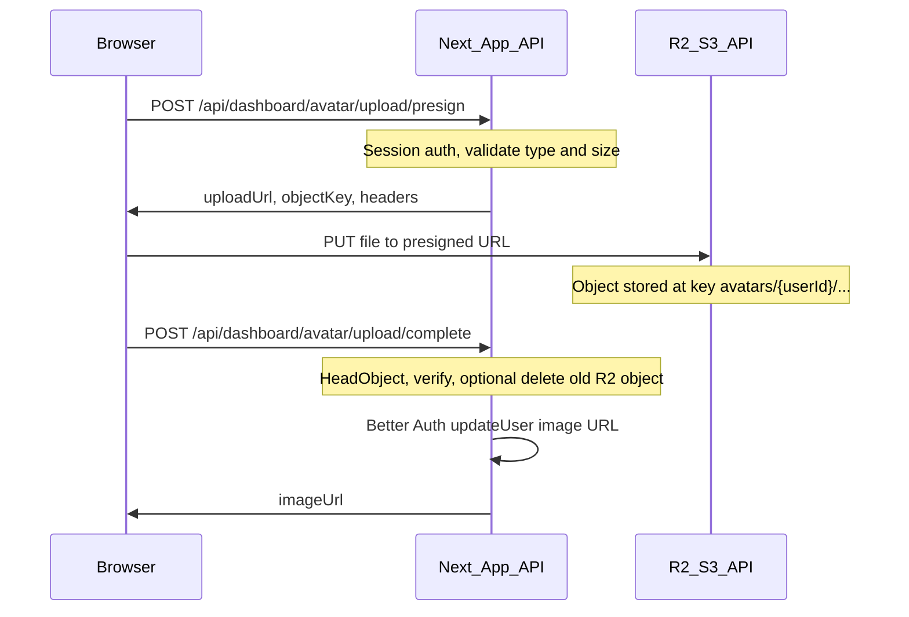

# Cloudflare R2: user avatar storage

This document describes how **user profile photos (avatars)** are stored in **Cloudflare R2** using the **S3-compatible API**, how that coexists with **Cloudinary** for admin/content assets, and how to configure and operate it.

It reflects the implementation in the repository as of the authoring date; when in doubt, prefer the source files listed in [Source map](#source-map).

---

## Goals and scope

| Area                                                                   | Storage             | Notes                                                                                                                                                     |
| ---------------------------------------------------------------------- | ------------------- | --------------------------------------------------------------------------------------------------------------------------------------------------------- |
| Admin / content manager media (`media_files`, `/api/content/assets/*`) | **Cloudinary**      | Unchanged; signed uploads, DB rows in `media_files`.                                                                                                      |
| End-user profile image (`users.image`) when using “Upload photo”       | **Cloudflare R2**   | Presigned **PUT** from the browser; URL persisted via Better Auth `updateUser`.                                                                           |
| OAuth profile images (Google / GitHub)                                 | External HTTPS URLs | Still written to `users.image`; not stored in R2 unless the user uploads a custom photo.                                                                  |
| **Journal daily cover** (per calendar day)                             | **Cloudflare R2**   | Same bucket and env gate as avatars; metadata in `user_media_files`, FK on `journal_daily`. See [R2_JOURNAL_DAILY_COVER.md](./R2_JOURNAL_DAILY_COVER.md). |

**Out of scope for this doc:** a dedicated `avatars` database table (the URL lives on `users.image` only). Journal covers are documented in the journal R2 doc above (not Cloudinary `media_files`).

---

## High-level architecture



1. **Presign:** Authenticated user asks for permission to upload one file; the server returns a time-limited URL and an object key the user is allowed to complete.
2. **Direct upload:** The browser uploads bytes to R2 (not through the Next.js body), so large files do not hit the app server’s request size limits.
3. **Complete:** The server verifies the object exists and matches policy, then updates the user’s `image` field to the **public** URL built from `R2_PUBLIC_BASE_URL` + key.

---

## Environment variables

Variables are validated in [`src/server/lib/env.ts`](../../src/server/lib/env.ts) with Zod.

### Required cluster (all five, or all omitted)

R2 avatar uploads are **disabled** until every variable below is set. If any one of these five is set, **all five must be set** (see `superRefine` in `env.ts`).

| Variable               | Purpose                                                                                                                                                                                                       |
| ---------------------- | ------------------------------------------------------------------------------------------------------------------------------------------------------------------------------------------------------------- |
| `R2_ACCOUNT_ID`        | Cloudflare account ID used in the default S3 API hostname `https://{R2_ACCOUNT_ID}.r2.cloudflarestorage.com`.                                                                                                 |
| `R2_ACCESS_KEY_ID`     | R2 API token access key (S3 “Access Key ID”).                                                                                                                                                                 |
| `R2_SECRET_ACCESS_KEY` | R2 API token secret.                                                                                                                                                                                          |
| `R2_BUCKET_NAME`       | Target bucket name.                                                                                                                                                                                           |
| `R2_PUBLIC_BASE_URL`   | **Public** HTTPS origin used to build URLs stored in `users.image` (e.g. custom domain, or `https://pub-xxxxx.r2.dev`). **No trailing slash.** Must match how browsers and `next/image` will load the object. |

### Optional

| Variable                    | Purpose                                                                                                                                                                                                                                                                                                                                                                                                                            |
| --------------------------- | ---------------------------------------------------------------------------------------------------------------------------------------------------------------------------------------------------------------------------------------------------------------------------------------------------------------------------------------------------------------------------------------------------------------------------------- |
| `R2_S3_ENDPOINT`            | Full S3 API base URL (e.g. `https://<account_id>.r2.cloudflarestorage.com`). If unset, the client uses the default pattern above. Use this to match the Cloudflare dashboard “S3 API” URL exactly or to override the default host without changing code.                                                                                                                                                                           |
| `NEXT_PUBLIC_R2_PUBLIC_URL` | Same **origin** as `R2_PUBLIC_BASE_URL` when both are set (see [`env.ts`](../../src/server/lib/env.ts)). Used first by [`next.config.ts`](../../next.config.ts) `images.remotePatterns` at **build** time (Docker copies [`.env.build`](../../.env.build); GitHub Actions can override via repository secret). Keeps `next/image` aligned with stored object URLs without putting the whole R2 secret cluster into the build file. |

### Runtime flag (derived)

| Export                   | Location                | Meaning                                                  |
| ------------------------ | ----------------------- | -------------------------------------------------------- |
| `r2AvatarStorageEnabled` | `src/server/lib/env.ts` | `true` when the five required variables are all present. |

---

## Cloudflare setup checklist

1. **Create a bucket** for user uploads (dedicated bucket recommended).
2. **R2 API token** with permission to read/write objects on that bucket (S3-compatible access key + secret).
3. **Public access to objects** you intend to expose by URL (e.g. public bucket, or custom domain / r2.dev public URL). The app stores a full HTTPS URL in `users.image`; it does not proxy reads through Next.js.
4. **CORS** on the bucket: allow `PUT` from your web app’s origin (the browser uploads directly to R2). Include preflight headers your client sends (at minimum the app origin; `Content-Type` is set on the PUT).
5. **Align `R2_PUBLIC_BASE_URL`** with the URL users and `next/image` will use (same scheme and host as the object URLs Cloudflare serves).

---

## Constants and object layout

Defined in [`src/shared/constants/avatar-r2.constants.ts`](../../src/shared/constants/avatar-r2.constants.ts) (shared so server and client stay aligned).

| Constant                       | Value                                                | Role                                                            |
| ------------------------------ | ---------------------------------------------------- | --------------------------------------------------------------- |
| `AVATAR_ALLOWED_CONTENT_TYPES` | `image/jpeg`, `image/png`, `image/webp`, `image/gif` | SVG is intentionally excluded for avatars.                      |
| `AVATAR_MAX_UPLOAD_BYTES`      | `5 * 1024 * 1024` (5 MiB)                            | Enforced on presign (request body) and complete (`HeadObject`). |
| `AVATAR_OBJECT_KEY_PREFIX`     | `avatars`                                            | All avatar keys start with `avatars/`.                          |

### Object key format

```
avatars/{userId}/{cuid2}.{ext}
```

- `userId` is the authenticated session user id.
- `cuid2` comes from `@paralleldrive/cuid2`.
- `ext` is derived from the declared content type (`jpg`, `png`, `webp`, `gif`).

Users cannot presign or complete keys for another user: completion checks `objectKey.startsWith("avatars/" + userId + "/")`.

---

## Server implementation

### S3 client and helpers

[`src/server/lib/r2.ts`](../../src/server/lib/r2.ts)

- **`getR2S3Client()`** — Singleton `S3Client` with `region: "auto"`, `forcePathStyle: true`, and `endpoint` from `R2_S3_ENDPOINT` or the default account-based URL.
- **`buildAvatarObjectKey(userId, contentType)`** — Builds the key under `avatars/`.
- **`publicUrlForR2ObjectKey(key)`** — `{R2_PUBLIC_BASE_URL}/{key}` with slashes normalized.
- **`tryParseR2ObjectKeyFromPublicUrl(url)`** — If `url` starts with `R2_PUBLIC_BASE_URL`, returns the object key substring; used for best-effort deletion of the previous avatar when replacing.
- **`presignAvatarPut(objectKey, contentType)`** — `PutObjectCommand` signed with **`@aws-sdk/s3-request-presigner`**, `expiresIn: 300` (5 minutes). Returns `uploadUrl` and `headers` including `Content-Type` (the browser must send the same `Content-Type` on PUT).
- **`headR2Object` / `deleteR2Object`** — Used on complete and optional cleanup.

### Service layer

[`src/server/modules/users/avatar-r2.service.ts`](../../src/server/modules/users/avatar-r2.service.ts)

| Method                                        | Behavior                                                                                                                                                                                                                                                                |
| --------------------------------------------- | ----------------------------------------------------------------------------------------------------------------------------------------------------------------------------------------------------------------------------------------------------------------------- |
| `presignUpload(userId, dto)`                  | Fails with **503** if R2 is not configured. Validates `fileSize` ≤ max. Builds key, returns presigned URL + headers.                                                                                                                                                    |
| `completeUpload(userId, dto, requestHeaders)` | Verifies key prefix, `HeadObject` for size and content type, loads profile, **best-effort** `DeleteObject` on previous key if previous `users.image` was under the same `R2_PUBLIC_BASE_URL`, then **`userService.updateUserImage(userId, imageUrl, requestHeaders)`**. |

### Persistence (`users.image`)

[`src/server/modules/users/user.service.ts`](../../src/server/modules/users/user.service.ts) — `updateUserImage` calls Better Auth:

```ts
await auth.api.updateUser({
  headers,
  body: { image: imageUrl },
});
```

The database column is `users.image` (see [`user.entity.ts`](../../src/server/modules/users/user.entity.ts)).

### Request DTOs (Zod)

[`src/server/modules/users/avatar-r2.dto.ts`](../../src/server/modules/users/avatar-r2.dto.ts)

- **Presign body:** `{ contentType, fileSize }` — `contentType` must be one of the allowed enum values; `fileSize` positive integer ≤ `AVATAR_MAX_UPLOAD_BYTES`.
- **Complete body:** `{ objectKey }` — string length 1–512; ownership enforced in the service.

### HTTP API

| Method | Path                                    | Auth                                      | Handler                                                                             |
| ------ | --------------------------------------- | ----------------------------------------- | ----------------------------------------------------------------------------------- |
| `POST` | `/api/dashboard/avatar/upload/presign`  | Session (`withAuth` + `withErrorHandler`) | [`avatar-r2.controller.ts`](../../src/server/modules/users/avatar-r2.controller.ts) |
| `POST` | `/api/dashboard/avatar/upload/complete` | Session                                   | Same                                                                                |

Route files:

- [`src/app/api/dashboard/avatar/upload/presign/route.ts`](../../src/app/api/dashboard/avatar/upload/presign/route.ts)
- [`src/app/api/dashboard/avatar/upload/complete/route.ts`](../../src/app/api/dashboard/avatar/upload/complete/route.ts)

Responses use the standard app envelope: `{ success: true, data, timestamp }` (see [`ApiSuccess`](../../src/shared/types/api-response.types.ts)).

### Dashboard bootstrap

[`GET /api/dashboard/settings`](../../src/app/api/dashboard/settings/route.ts) includes **`avatarR2UploadEnabled`** (same as `r2AvatarStorageEnabled`) so the UI can hide the upload control when R2 is not configured.

Types: [`src/lib/api/api-server.ts`](../../src/lib/api/api-server.ts) (`DashboardSettingsBootstrap`), [`user.service.ts`](../../src/server/modules/users/user.service.ts) (`DashboardSettingsOverviewDTO`).

---

## Client implementation

### Browser helper

[`src/lib/assets/r2-avatar-upload.ts`](../../src/lib/assets/r2-avatar-upload.ts)

- **`uploadUserAvatarFromFile(file, onProgress, options?)`**
  1. `POST .../presign` with `{ contentType: file.type, fileSize: file.size }`.
  2. **`XMLHttpRequest` `PUT`** to `uploadUrl` with `presign.headers` (supports upload progress; `fetch` would not).
  3. `POST .../complete` with `{ objectKey: presign.objectKey }`.
- Uses `credentials: "include"` for session cookies on app API calls only (R2 PUT uses the presigned URL, no cookies).

### Settings UI

[`src/components/dashboard/linked-accounts.tsx`](../../src/components/dashboard/linked-accounts.tsx)

- Receives **`avatarR2UploadEnabled`** from the dashboard settings page.
- When `true`, shows “Custom photo” upload (file input + button, client-side MIME/size checks using the same constants).
- On success: updates local avatar preview, toast, **`router.refresh()`** so RSC-loaded session/bootstrap data updates.

[`src/app/[locale]/(dashboards)/dashboard/settings/page.tsx`](<../../src/app/[locale]/(dashboards)/dashboard/settings/page.tsx>) passes `avatarR2UploadEnabled={dashboardSettings.avatarR2UploadEnabled}`.

---

## Next.js `next/image`

[`next.config.ts`](../../next.config.ts) reads `process.env.NEXT_PUBLIC_R2_PUBLIC_URL` **first**, then `R2_PUBLIC_BASE_URL`, when building `images.remotePatterns`.

so optimized images can load from your R2 public hostname. For production builds, ensure at least one of these is set at **build time** if you rely on `next/image` for avatars.

---

## Dependencies

From [`package.json`](../../package.json):

- `@aws-sdk/client-s3` — `S3Client`, `PutObject`, `HeadObject`, `DeleteObject`.
- `@aws-sdk/s3-request-presigner` — presigned URLs for `PutObject`.

---

## Security summary

| Topic                  | Mitigation                                                                               |
| ---------------------- | ---------------------------------------------------------------------------------------- |
| Anonymous uploads      | Presign and complete require an authenticated session.                                   |
| Cross-user overwrite   | Object key must start with `avatars/{sessionUserId}/`.                                   |
| Oversized / wrong type | Zod on presign; `HeadObject` on complete.                                                |
| Long-lived write URLs  | Presigned PUT expires in **300 seconds**.                                                |
| Secret leakage         | Keys and bucket name stay server-side; only presigned URL + public URL touch the client. |

---

## Troubleshooting

| Symptom                     | Things to check                                                                                                                    |
| --------------------------- | ---------------------------------------------------------------------------------------------------------------------------------- |
| Upload control missing      | `avatarR2UploadEnabled` false → verify all **five** required env vars; restart app after changes.                                  |
| `503` on presign/complete   | Same as above, or server failed to read env.                                                                                       |
| `422` on complete           | PUT did not finish, wrong `Content-Type`, or object missing / wrong type / size.                                                   |
| PUT fails from browser      | Bucket **CORS** (origin, `PUT`, headers).                                                                                          |
| Image broken in UI          | `R2_PUBLIC_BASE_URL` must match real public URLs; bucket/domain must allow **public read** for those objects.                      |
| `next/image` refuses R2 URL | Build/runtime `R2_PUBLIC_BASE_URL` or `NEXT_PUBLIC_R2_PUBLIC_URL` and `remotePatterns` hostname.                                   |
| Old avatar not deleted      | Deletion only runs if the **previous** `users.image` URL starts with the configured `R2_PUBLIC_BASE_URL` (OAuth URLs are skipped). |

---

## Source map

| Concern                                      | Primary files                                                                                                                                     |
| -------------------------------------------- | ------------------------------------------------------------------------------------------------------------------------------------------------- |
| Env schema and `r2AvatarStorageEnabled`      | `src/server/lib/env.ts`                                                                                                                           |
| S3 client, keys, URLs, presign, head, delete | `src/server/lib/r2.ts`                                                                                                                            |
| Business rules for avatar flow               | `src/server/modules/users/avatar-r2.service.ts`                                                                                                   |
| HTTP entry                                   | `src/server/modules/users/avatar-r2.controller.ts`, `src/server/modules/users/avatar-r2.dto.ts`, `src/app/api/dashboard/avatar/upload/*/route.ts` |
| Shared limits / MIME / prefix                | `src/shared/constants/avatar-r2.constants.ts`                                                                                                     |
| Client orchestration                         | `src/lib/assets/r2-avatar-upload.ts`                                                                                                              |
| UI                                           | `src/components/dashboard/linked-accounts.tsx`, settings page                                                                                     |
| Bootstrap flag                               | `src/server/modules/users/user.service.ts`, `src/lib/api/api-server.ts`                                                                           |
| `next/image` allowlist                       | `next.config.ts`                                                                                                                                  |
| Admin Cloudinary (unchanged)                 | `src/server/modules/assets/*`, `src/lib/assets/upload.ts`                                                                                         |

---

## Related: journal daily covers on R2

Implemented separately from avatars but **same R2 credentials and `r2AvatarStorageEnabled` gate**: presign/complete under `/api/dashboard/user-media/journal-daily-cover/*`, keys under `user-media/journal_daily_cover/...`, persistence in `user_media_files` + `journal_daily.cover_image_id`. Full write-up: [R2_JOURNAL_DAILY_COVER.md](./R2_JOURNAL_DAILY_COVER.md).
